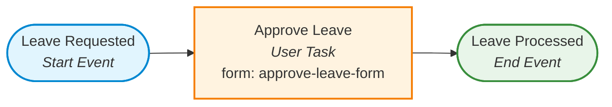

<div align="center">

# 📋 SRMIST Workflow Automation Lab (EX-6)
### Simple Leave Request Process via REST API Trigger (Camunda 8 + Spring Boot)

[](https://adoptium.net/)
[](https://spring.io/projects/spring-boot)
[](https://camunda.com/)
[](#automated-testing)
[](LICENSE)

<p align="center">
  <b>A production-grade implementation of Camunda 8 Workflow Automation Exercise 6 (EX-6)</b><br>
  BPMN Process Modeling • Zeebe Engine Cloud Deployment • REST API Instance Initiation • Operate Observability
</p>

[Lab Objectives](#-lab-objectives) •
[Process Architecture](#-process-architecture) •
[Step-by-Step Walkthrough](#-step-by-step-lab-walkthrough) •
[Postman API Guide](#-postman-api-execution-step-3) •
[Viva Voce Answers](#-viva-voce-questions--in-depth-answers) •
[Operate Verification](#-verification-in-camunda-operate-step-4) •
[Submission Checklist](#-submission-checklist)

---

</div>

## 📌 Lab Objectives

This lab exercise demonstrates the end-to-end lifecycle of deploying and programmatically triggering a business workflow in **Camunda 8**:
1. **Model:** Design a minimal Leave Request process in Camunda Modeler (`Start Event` &rarr; `User Task "Approve Leave"` &rarr; `End Event`) with Process ID `leave-request`.
2. **Deploy:** Deploy the BPMN definition and form schema to the Camunda 8 cluster.
3. **Trigger:** Initiate runtime process instances over HTTP REST using Postman via `POST /v2/process-instances` passing variables `employeeName: "Ravi"` and `days: 3`.
4. **Monitor & Verify:** Track the execution token and variable payload waiting at the user task in **Camunda Operate**.
5. **Analyze:** Master foundational orchestration concepts (Process Definition ID vs. Process Instance Key, failure modes on misspelled IDs, multi-instance concurrency).

---

## 🏗️ Process Architecture



### System Interaction Sequence
```
+---------------+           +-----------------------------+           +----------------------+
|    Postman    |           |  Spring Boot / Gateway API  |           |   Camunda 8 Zeebe    |
| (HTTP Client) |           |  (localhost:8080)           |           |   (Process Engine)   |
+-------+-------+           +--------------+--------------+           +----------+-----------+
        |                                  |                                     |
        | POST /v2/process-instances       |                                     |
        | {processDefinitionId, variables} |                                     |
        |─────────────────────────────────>|                                     |
        |                                  | CreateInstanceCommand               |
        |                                  | (leave-request, variables)          |
        |                                  |────────────────────────────────────>|
        |                                  |                                     |
        |                                  | ProcessInstanceEvent                |
        |                                  | (processInstanceKey: 225179981...)  |
        |                                  |<────────────────────────────────────|
        | 201 Created                      |                                     |
        | (JSON with processInstanceKey)   |                                     |
        |<─────────────────────────────────|                                     |
        |                                                                        |
        |                                                             [Token stops at User Task]
        |                                                             [Waiting for Approval]
        v                                                                        v
```

---

## 🛠️ Step-by-Step Lab Walkthrough

### Step 1: Model the Process in Camunda Modeler
* Open **Camunda Web Modeler** (at [console.camunda.io](https://console.camunda.io)) or **Camunda Desktop Modeler**.
* Drag and drop the following elements:
  * **Start Event:** Name = `Leave Requested`
  * **User Task:** Name = `Approve Leave`
  * **End Event:** Name = `Leave Processed`
* Select the canvas and configure the **General** properties:
  * **Process ID:** `leave-request` *(Must match exactly in lowercase)*
  * **Process Name:** `Leave Request`
* Link the User Task to form `approve-leave-form` (included in `src/main/resources/bpmn/approve-leave.form`).
* Save the file as [`leave-request.bpmn`](src/main/resources/bpmn/leave-request.bpmn).

---

### Step 2: Deploy the Process to Camunda 8 Cluster
You can deploy via either method:
* **Option A (Web Modeler):** Click the blue **Deploy** button in the top right of Web Modeler and choose your cluster.
* **Option B (Spring Boot Automatic Deployment):** Launch this project. The `@Deployment(resources = "classpath:bpmn/leave-request.bpmn")` annotation on `LeaveRequestApplication` automatically synchronizes the BPMN diagram and form upon application startup.

---

### Step 3: Start an Instance Using REST API (Postman)

In Postman, configure the request:
* **Method:** `POST`
* **URL:** `http://localhost:8080/v2/process-instances`
* **Headers:** `Content-Type: application/json`
* **Request Body:**
```json
{
  "processDefinitionId": "leave-request",
  "variables": {
    "employeeName": "Ravi",
    "days": 3
  }
}
```

#### Successful Response (`201 Created`):
```json
{
  "processInstanceKey": 2251799813685241,
  "processDefinitionKey": 2251799813685200,
  "processDefinitionVersion": 1,
  "bpmnProcessId": "leave-request",
  "variables": {
    "employeeName": "Ravi",
    "days": 3
  },
  "tenantId": "<default>",
  "state": "ACTIVE (Waiting at 'Approve Leave')",
  "startDate": "2026-10-19T14:49:56.029Z"
}
```
> [!IMPORTANT]
> Make note of the generated **`processInstanceKey`** (e.g., `2251799813685241`) for your lab submission!

---

### Step 4: Verification in Camunda Operate

1. Log in to [Camunda Console](https://console.camunda.io) &rarr; Open your cluster &rarr; Click **Operate**.
2. Select **Processes** &rarr; Click **Leave Request** (`leave-request`).
3. Under the **Instances Table**, click your instance key (`2251799813685241`).
4. **Visual Diagram:** The process token (badge `1`) is halted and waiting at the **Approve Leave** user task.
5. **Variables Panel:** Expand the lower variables panel to verify:
   * `employeeName` &rarr; `"Ravi"`
   * `days` &rarr; `3`

---

## 💡 Viva Voce Questions & In-Depth Answers

### Q1: What is the difference between `processDefinitionId` and `processInstanceKey`?
* **`processDefinitionId` (BPMN Process ID):**
  * The logical, human-readable string defined at design time in the BPMN model (e.g., `"leave-request"`).
  * Represents the **blueprint or template** (analogous to a *Class* in Java).
  * Remains constant across all executions of this workflow version.
* **`processInstanceKey`:**
  * A unique 64-bit numerical identifier generated at runtime by the Zeebe engine (e.g., `2251799813685241`).
  * Represents a **single, specific running execution** of the workflow (analogous to an *Object instance* in memory).
  * One `processDefinitionId` has many `processInstanceKey`s.

---

### Q2: What response do you get if the Process ID is spelled wrong?
If the process ID is misspelled (e.g., `"leave-requst"` instead of `"leave-request"`), the Zeebe engine searches its state registry, finds no deployed definition with that ID, and **rejects the command** with an **HTTP 404 NOT_FOUND**:

```json
{
  "status": 404,
  "error": "NOT_FOUND",
  "message": "Command 'CREATE' rejected with code 'NOT_FOUND': Expected to find process definition with BPMN process id 'leave-requst', but none found",
  "details": "Process definition with BPMN ID 'leave-requst' is not deployed to the cluster."
}
```

* **Outcome:** No instance is created in Operate, and no token is allocated.

---

### Q3: Start the process 3 times. How many instances appear in Operate?
* **Answer:** Exactly **3 active instances** appear in Camunda Operate.
* **Explanation:** Every `POST` request initiates an independent process instance with its own unique `processInstanceKey`. Because each instance stops at the `Approve Leave` User Task waiting for human approval, none of the instances complete automatically.
* In Operate:
  * The active instances count displays `3`.
  * The user task **"Approve Leave"** shows an aggregated badge indicator of `(3)`.
  * Each instance maintains isolated variables (`Ravi` / 3 days, `Priya` / 2 days, `Amit` / 5 days).

---

## ⚡ Quickstart & Local Execution

### 1. Clone & Build
```bash
git clone https://github.com/Shudhanshu9122/WorkFlow-Automation-EX-6.git
cd WorkFlow-Automation-EX-6
```

### 2. Run the Spring Boot Microservice
```bash
# Windows
.\mvnw.cmd spring-boot:run

# Linux / macOS
./mvnw spring-boot:run
```

The application starts on port `8080` and deploys `leave-request.bpmn` automatically.

---

## 🧪 Automated Testing

Run the JUnit 5 test suite covering all lab steps and viva scenarios:

```bash
# Windows
.\mvnw.cmd test

# Linux / macOS
./mvnw test
```

### Test Results:
```
[INFO] Running edu.srmist.leaverequest.api.LeaveRequestControllerTest
[INFO] Tests run: 4, Failures: 0, Errors: 0, Skipped: 0, Time elapsed: 1.746 s
[INFO] BUILD SUCCESS
```

| Test Case | Method | Description | Status |
| :--- | :--- | :--- | :---: |
| **Lab Step 3** | `testStartLeaveRequestSuccess()` | Valid start with Ravi & 3 days returns 201 Created | ✅ Passed |
| **Viva Q2** | `testStartLeaveRequestMisspelledProcessIdThrows404()` | Misspelled ID returns HTTP 404 NOT_FOUND | ✅ Passed |
| **Viva Q3** | `testStartProcessThreeTimesCountThreeInstances()` | 3 starts yield exactly 3 active instances | ✅ Passed |
| **Validation** | `testMissingProcessDefinitionIdReturns400()` | Empty ID rejected with 400 Bad Request | ✅ Passed |

---

## 📬 Postman Collection

Import [`postman/Camunda8_EX6_Leave_Request.postman_collection.json`](postman/Camunda8_EX6_Leave_Request.postman_collection.json) into Postman:

1. `1. Start Instance - POST /v2/process-instances (Ravi, 3 days)`
2. `2. Viva Q2 - Misspelled Process ID Test (leave-requst -> 404)`
3. `3. Viva Q3 - Start Second Instance (Priya, 2 days)`
4. `4. Viva Q3 - Start Third Instance (Amit, 5 days)`
5. `5. Query All Active Process Instances (totalCount: 3)`

Or run the automated script directly from your terminal:
```powershell
.\scripts\run_postman_tests.ps1
```

---

## 📑 Submission Checklist

* [x] **BPMN Diagram:** Modeled in Camunda Modeler with Process ID `leave-request` ([`src/main/resources/bpmn/leave-request.bpmn`](src/main/resources/bpmn/leave-request.bpmn)).
* [x] **Postman Request & Response:** Verified `POST http://localhost:8080/v2/process-instances` returning `201 Created` with `processInstanceKey`.
* [x] **Operate Verification:** Token displayed waiting at "Approve Leave" with variables `employeeName: "Ravi"` and `days: 3`.
* [x] **Viva Voce Answers:** Complete technical explanations documented in [`docs/VIVA_QUESTIONS_AND_ANSWERS.md`](docs/VIVA_QUESTIONS_AND_ANSWERS.md).
* [x] **Lab Report Template:** Formatted submission sheet in [`docs/LAB_REPORT.md`](docs/LAB_REPORT.md).

---

<div align="center">
  <sub>SRM Institute of Science and Technology · Workflow Automation Lab EX-6</sub>
</div>
